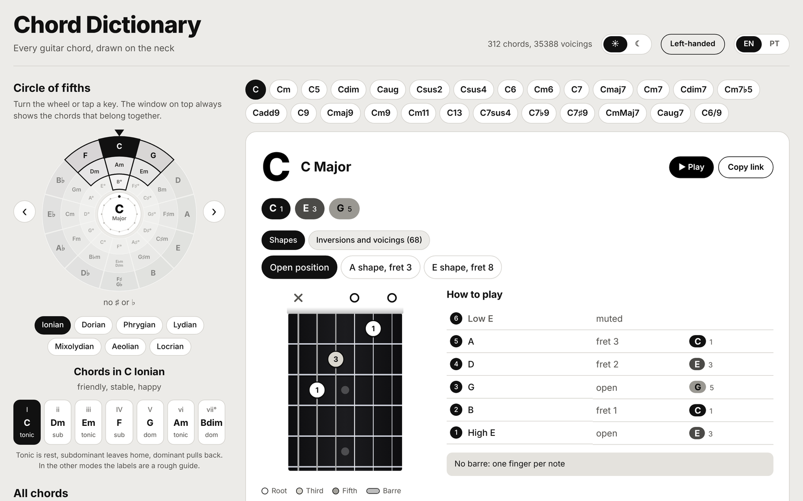

# Chord Dictionary

**Live site:** https://chord-dictionary-sooty.vercel.app (English and Portuguese, works on phones, nothing to install)

**Install it like an app:** open the site in Chrome, Edge or Safari and use *Install app* (or *Add to Home Screen* on iPhone). After the first visit it also works offline.



An open-source, interactive **guitar chord dictionary**. Search any chord, see it drawn on the fretboard, and switch between voicings (open shapes and movable barre shapes up the neck).

- **312 chords**: all 12 keys x 26 chord types, from triads to 9ths, 11ths and 13ths
- **559 voicings**: open-position shapes where they exist, plus E-shape and A-shape barre chords
- **Inversions and compact voicings**: over 12,000 voicings, every one machine-checked. Closed and open triads, closed, drop 2 and drop 3 four-note chords, shells (root, third, seventh) and rootless voicings, each in every inversion on several string sets and positions, with a filter by kind and by note in the bass
- **Arpeggios**: the notes of the chord on screen across the neck, in five positions tied to the CAGED shapes
- **Progression builder**: build a sequence, hear it, move it to another key and see the Roman numerals
- **Practice tools**: metronome with quarter, eighth, triplet and sixteenth subdivisions, a chord quiz (by sight or by ear) and a left-handed mirror mode
- **Listen**: play any voicing as a strum, or any scale up and down (Web Audio, no files)
- **Share**: copy a link that opens straight on the chord
- **Circle of fifths, modes and 20 scales**, light and dark themes, installable and offline
- **CAGED system**: 240 chords (20 types x 12 keys), every one with all five shapes (C, A, G, E, D), derived from the parent triad shapes and machine-checked, including 9ths, 11th, 13th, 7sus4, 7b9, 7#9, mMaj7, aug7 and 6/9
- **Study guide**: tension and rest, cadences, chords of a key, dominants and tritone substitution, borrowed chords and modes, jazz-standard patterns and practice tips, with every example shown in the key you are in and playable
- **Scales meet CAGED**: for major, minor and pentatonic scales, each position shows which CAGED shape of the tonic chord it holds
- **Every voicing is machine-checked**: tests compute the notes each string actually sounds in standard tuning (E A D G B E) and fail if a shape does not spell its chord
- Search by name or symbol (`Am`, `C#m7`, `Bb`, `sus4`), filter by key and type
- **Circle of fifths wheel** with a fixed window: turn the wheel (drag, arrow keys or the side buttons) and the window always frames the seven chords of that key, with Roman numerals
- **Modes**: Ionian to Locrian on the same wheel (D Dorian turns the wheel to C major and relabels the degrees)
- **20 scales on a full neck**: the seven modes, major and minor pentatonic, blues, harmonic and melodic minor, Phrygian dominant, Lydian dominant, altered, double harmonic, whole tone and both diminished scales. Notes are spelled correctly (F# major has E#), shown as names or degrees, with five-fret positions and the tones of the chord you are viewing ringed
- Light and dark themes (follows your system, switchable), English and Portuguese
- Responsive React UI with SVG chord diagrams (nut, fret position, barres, open and muted strings)

## CAGED system

Every major, minor, 7, maj7, m7, sus2, sus4, 6 and m6 chord shows the five CAGED forms: the same chord played with the shapes of the open **C, A, G, E and D** chords, moved up the neck so the root lands on the right note. The forms are listed from the lowest fret upward, so for C major you get C (open), A (fret 3), G (fret 5), E (fret 8) and D (fret 10). Each diagram marks the barre, open and muted strings.

The data is in the `caged` array of each chord (`form`, `order`, `lowestFret`, `positions`, `baseFret`, optional `barre`). Diminished, augmented, power, add9 and half-diminished chords are symmetrical or have no standard CAGED family, so they only have the regular voicings.

## Chord types

Major, Minor, Power (5), Diminished, Augmented, Suspended 2, Suspended 4, Major 6, Minor 6, Dominant 7, Major 7, Minor 7, Diminished 7, Half-diminished (m7b5), Add9, Dominant 9, Major 9, Minor 9, Minor 11, Dominant 13, 7sus4, 7b9, 7#9, Minor-major 7, Augmented 7, 6/9.

Each chord is spelled the way a musician would write it (Bb major is Bb D F, not A# D F). Both spellings work in search (`Db` or `C#`).

## Sources of the study material

The concepts in the study guide are summaries, in our own words, of ideas taught in *Segredos da Harmonia* (course and e-book) and the *Toolbox* sheets by Kiko Loureiro, and *Standards do Jazz* by Ted Gioia. Exercises and tablature from those materials are not reproduced; use the originals for the full lessons.

## Contributing

See [CONTRIBUTING.md](CONTRIBUTING.md).

## Getting started

Requires Node.js 18+. The website needs no server: the chord data is bundled into the app and searched in the browser.

```bash
git clone https://github.com/thiagocostacontatomusic-dot/chord-dictionary.git
cd chord-dictionary/frontend
npm install
npm start          # http://localhost:3000
```

`npm start` and `npm run build` first copy `backend/chords.json` into `frontend/src/`, so regenerating the data (below) updates the site too.

## Regenerating and testing the data

```bash
cd backend
npm install
npm run generate   # rebuilds chords.json from scripts/chord-theory.js
npm test           # checks every voicing note by note
```

## Publishing your own copy

The site is a static React build in `frontend/`. Import the repository on [Vercel](https://vercel.com) or Netlify, set the root directory to `frontend` and deploy; every push to `main` republishes it. Any static host works (`npm run build` produces `frontend/build`).

## Optional API

The same data is also available as a small REST API for other apps:

```bash
cd backend && npm install && npm start   # http://localhost:8000
```

### Endpoints

| Endpoint | Description |
| --- | --- |
| `GET /api/chords` | All chords. Query: `search`, `note`, `type` |
| `GET /api/chords/:id` | One chord, e.g. `C_major`, `Fsharp_min7` |
| `GET /api/notes` | Available roots |
| `GET /api/types` | Available chord types |
| `GET /api/stats` | Counts of chords, voicings and CAGED chords |

A chord looks like:

```json
{
  "id": "C_major",
  "name": "C Major",
  "symbol": "C",
  "note": "C",
  "type": "Major",
  "notes": ["C", "E", "G"],
  "voicings": [
    {
      "label": "Open position",
      "baseFret": 1,
      "positions": [
        { "string": 6, "fret": null },
        { "string": 5, "fret": 3 },
        { "string": 4, "fret": 2 },
        { "string": 3, "fret": 0 },
        { "string": 2, "fret": 1 },
        { "string": 1, "fret": 0 }
      ]
    }
  ]
}
```

Strings are numbered 6 (low E) to 1 (high E). `fret: null` means muted, `0` means open. A voicing may include a `barre` (`fret`, `fromString`, `toString`).

## How the data is made

`backend/chords.json` is generated by `backend/scripts/generate-chords.js` from chord formulas and shapes in `backend/scripts/chord-theory.js`. Every voicing must pass `validateVoicing` (root in the bass, every chord tone present, nothing foreign, a playable stretch) or generation fails.

```bash
cd backend
npm run generate   # rebuild chords.json
npm test           # re-verify every shipped voicing
```

## Contributing

Contributions are welcome, especially:

- more voicings (alternate shapes, higher inversions, 9th/11th/13th chords)
- CAGED forms for more chord types (add the five parent shapes to `CAGED_SHAPES` in `chord-theory.js`)
- alt tunings (Drop D, DADGAD, open G)
- finger numbers on the diagrams
- piano and ukulele views

To add a shape, edit `chord-theory.js` (movable and CAGED shapes) or the `OPEN` table in `generate-chords.js` (open shapes), run `npm run generate && npm test`, and open a pull request.

## License

[MIT](LICENSE)
